# BBBC Datasets (2D/3D) - A PyTorch Dataset Manager

## 📌 Overview

This package provides a **PyTorch-compatible dataset manager** for
[Broad Bioimage Benchmark Collection (BBBC) datasets](https://bbbc.broadinstitute.org/image_sets).

It covers **27 image sets** — 24 segmentation sets (foreground, outline and
instance masks) and 3 cell-counting sets (BBBC001, BBBC002, BBBC044). Every
set carries fixed-schema metadata (`dim`, `imaging_mode`, `task`,
`label_type`, ...) that you can query and filter on.

It allows users to:

- **Download and manage BBBC segmentation datasets automatically**
- **Load datasets as PyTorch `Dataset` objects**
- **Handle 2D & 3D images properly**
- **Support image augmentations via `torchvision.transforms`** (#TODO)

## 🚀 Installation

<details>
<summary> Install from PyPI </summary>

```bash
pip install bbbc-datasets
```

</details>

<details>
<summary> Install from Source </summary>

#### Clone the Repository

```bash
git clone https://github.com/mario-koddenbrock/bbbc_datasets.git
cd bbbc_datasets
```

#### Install Dependencies

```bash
pip install -r requirements.txt
```

##### Dependencies:

- `torch`, `torchvision` (Deep Learning Framework)
- `numpy`, `tifffile`, `opencv-python` (Image Handling)
- `requests`, `matplotlib` (Downloading & Visualization)

</details>

---

## 📂 Available Datasets

You can list all available BBBC datasets without downloading them. 
You can also filter the datasets to show only 2D, only 3D, or both types of datasets.

```python
from examples.load_dataset import list_available_datasets

# List all datasets
list_available_datasets()

# List only 2D datasets
list_available_datasets(filter_3d=False)

# List only 3D datasets
list_available_datasets(filter_3d=True)
```

<details>
<summary> Output </summary>

```
📂 Available BBBC Datasets:
- BBBC001: Human HT29 colon-cancer cells for counting.
- BBBC002: Drosophila Kc167 cells for counting.
- BBBC003: DIC microscopy images of mouse embryos for segmentation analysis.
- BBBC004: Synthetic fluorescence microscopy images of nuclei with varying clustering probabilities.
- BBBC005: Simulated fluorescence microscopy images with varying focus blur.
- BBBC006: Z-stack fluorescence microscopy images of human U2OS cells.
- BBBC007: Drosophila Kc167 cells for cell boundary segmentation.
- BBBC008: Dataset: Fluorescence microscopy images of human HT29 colon cancer cells.
- BBBC009: Human red blood cells (DIC images).
- BBBC010: Live/dead assay of C. elegans exposed to pathogens.
- BBBC018: Human HT29 colon-cancer cells (diverse phenotypes).
- BBBC019: Collective cell migration (wound healing, DIC images).
- BBBC020: Murine bone-marrow derived macrophages (overlapping cells).
- BBBC024: 3D Synthetic HL60 Cell Line Images with Varying Clustering Probability and SNR.
- BBBC027: 3D Synthetic Colon Tissue Images with Varying SNR.
- BBBC028: Polymerized Structures in Differential Interference Contrast (DIC) Microscopy.
- BBBC029: Synthetic Differential Interference Contrast (DIC) Images.
- BBBC030: Chinese Hamster Ovary (CHO) cells (DIC images).
- BBBC032: 3D Mouse Embryo Blastocyst Cells.
- BBBC033: 3D Mouse Trophoblast Stem Cells.
- BBBC034: 3D Induced Pluripotent Human Stem Cells (hiPSC).
- BBBC035: Simulated HL60 Cells from the Cell Tracking Challenge.
- BBBC038: Kaggle 2018 Data Science Bowl - Nuclei Segmentation.
- BBBC039: Nuclei of U2OS Cells in a Chemical Screen.
- BBBC044: Mouse hippocampal presynaptic terminals (vGlut-1 and vGat).
- BBBC046: FiloData3D - Synthetic 3D Time-Lapse Imaging of A549 Cells with Filopodia.
- BBBC050: Nuclei of Mouse Embryonic Cells.
```

</details>

### Filtering by metadata

Every dataset carries a fixed-schema `DatasetMetadata` object (the `METADATA`
class attribute, see [`bbbc_datasets/metadata.py`](bbbc_datasets/metadata.py))
describing its imaging setup and content. Unknown values are `None` — never
guessed.

```python
from bbbc_datasets.dataset_manager import DatasetManager

# Metadata of a single dataset
meta = DatasetManager.get_metadata("BBBC044")
meta.dim        # "3D"
meta.to_dict()  # plain dict (JSON-serializable)

# Filter by any metadata field (no downloads, no instantiation)
DatasetManager.filter_datasets(dim="3D")            # all 3D datasets
DatasetManager.filter_datasets(data_type="synthetic")
DatasetManager.filter_datasets(imaging_mode="dic", label_type="foreground")
DatasetManager.filter_datasets(task="counting")
# legacy: filter_3d=True/False is equivalent to dim="3D"/"2D"
```

Fields: `name`, `title`, `source`, `dim` (`2D`/`3D`), `imaging_mode`
(`fluorescence`/`dic`/`brightfield`/`brightfield_fluorescence`), `modality`
(`grayscale`/`rgb`/`multichannel`), `resolution_um` (tuple, `None` when not
uniform), `image_size` (`(H, W)` or `(Z, H, W)`, `None` when varying),
`data_type` (`synthetic`/`real`), `instrument`, `n_images`, `task`
(`segmentation`/`counting`/`detection`/`classification`), `label_type`
(`foreground`/`instance`/`outlines`/`counts`/`bounding_boxes`/`biological`),
`doi`, `license`.

### Dataset previews

Each dataset below is a collapsible entry with **three downscaled example
images** (the label mask is shown side by side when available) and the full
metadata. The thumbnails live in [`gallery/`](gallery) and are generated from
the downloaded data:

```python
from bbbc_datasets.dataset_manager import DatasetManager

# Regenerate the thumbnails (requires the datasets to be downloaded)
DatasetManager.gallery("gallery", examples=3, max_size=300)
# or: python -m bbbc_datasets.gallery --output gallery
```

> **Note:** some sets are named "3D" by the BBBC but this package processes
> single 2D frames of them (`BBBC032`–`BBBC035`, `BBBC046`); their metadata
> `dim` is therefore `2D`, matching the code's `is_3d` flag.

---

<details>
<summary><b><a href="https://bbbc.broadinstitute.org/BBBC001">BBBC001</a></b> — Human HT29 colon-cancer cells for counting · 2D · real · fluorescence · counting · 6 images</summary>

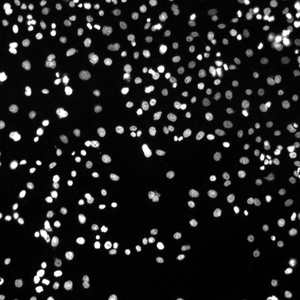 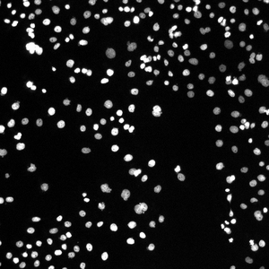 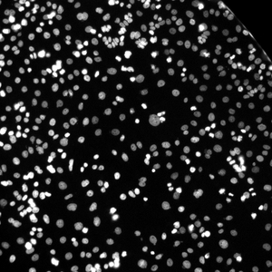

| | | | |
|---|---|---|---|
| **Dim** | 2D | **Imaging mode** | fluorescence |
| **Modality** | grayscale | **Data type** | real |
| **Image size** | 512×512 | **Resolution** | — |
| **Instrument** | Cellomics ArrayScan | **Images** | 6 |
| **Task** | counting | **Labels** | counts |
| **DOI** | 10.1038/nmeth.2083 | **License** | CC-BY-NC-SA-3.0 |

</details>

<details>
<summary><b><a href="https://bbbc.broadinstitute.org/BBBC002">BBBC002</a></b> — Drosophila Kc167 cells for counting · 2D · real · fluorescence · counting · 50 images</summary>

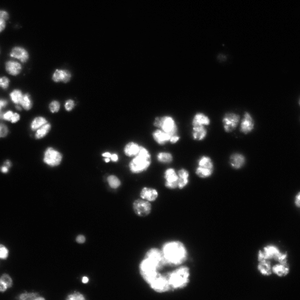 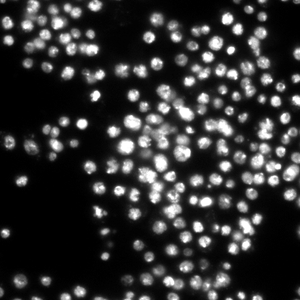 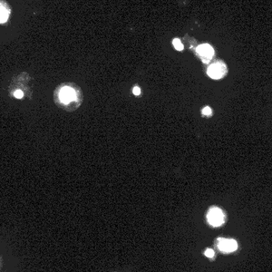

| | | | |
|---|---|---|---|
| **Dim** | 2D | **Imaging mode** | fluorescence |
| **Modality** | grayscale | **Data type** | real |
| **Image size** | 512×512 | **Resolution** | — |
| **Instrument** | Zeiss Axiovert 200M | **Images** | 50 |
| **Task** | counting | **Labels** | counts |
| **DOI** | 10.1038/nmeth.2083 | **License** | CC-BY-NC-SA-3.0 |

</details>

<details>
<summary><b><a href="https://bbbc.broadinstitute.org/BBBC003">BBBC003</a></b> — DIC microscopy images of mouse embryos for segmentation analysis · 2D · real · dic · segmentation · 15 images</summary>

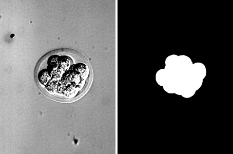 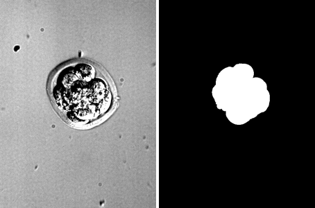 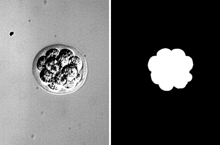

| | | | |
|---|---|---|---|
| **Dim** | 2D | **Imaging mode** | dic |
| **Modality** | grayscale | **Data type** | real |
| **Image size** | 480×640 | **Resolution** | — |
| **Instrument** | Nikon Eclipse TE200 (20x, 0.45 NA) | **Images** | 15 |
| **Task** | segmentation | **Labels** | foreground |
| **DOI** | — | **License** | — |

</details>

<details>
<summary><b><a href="https://bbbc.broadinstitute.org/BBBC004">BBBC004</a></b> — Synthetic fluorescence microscopy images of nuclei with varying clustering probabilities · 2D · synthetic · fluorescence · segmentation · 20 images</summary>

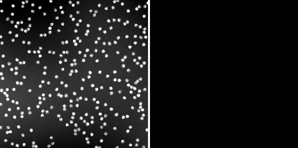 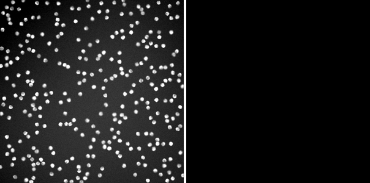 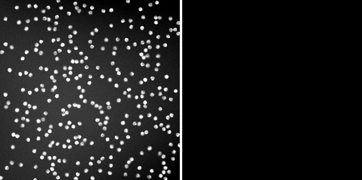

| | | | |
|---|---|---|---|
| **Dim** | 2D | **Imaging mode** | fluorescence |
| **Modality** | grayscale | **Data type** | synthetic |
| **Image size** | varies | **Resolution** | — |
| **Instrument** | — | **Images** | 20 |
| **Task** | segmentation | **Labels** | foreground |
| **DOI** | — | **License** | — |

</details>

<details>
<summary><b><a href="https://bbbc.broadinstitute.org/BBBC005">BBBC005</a></b> — Simulated fluorescence microscopy images with varying focus blur · 2D · synthetic · fluorescence · segmentation · 19200 images</summary>

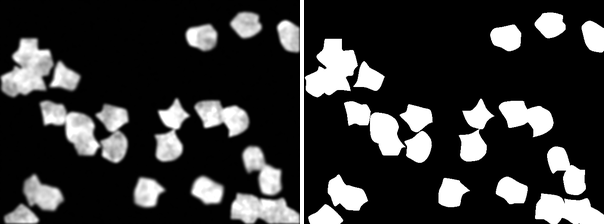 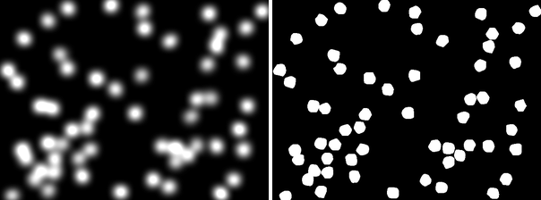 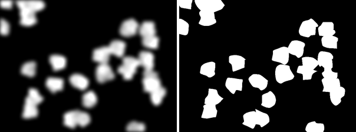

| | | | |
|---|---|---|---|
| **Dim** | 2D | **Imaging mode** | fluorescence |
| **Modality** | grayscale | **Data type** | synthetic |
| **Image size** | varies | **Resolution** | — |
| **Instrument** | — | **Images** | 19200 |
| **Task** | segmentation | **Labels** | foreground |
| **DOI** | — | **License** | — |

</details>

<details>
<summary><b><a href="https://bbbc.broadinstitute.org/BBBC006">BBBC006</a></b> — Z-stack fluorescence microscopy images of human U2OS cells · 2D · real · fluorescence · segmentation · 1536 images</summary>

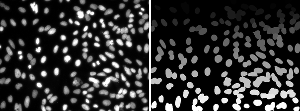 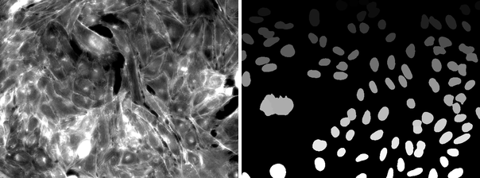 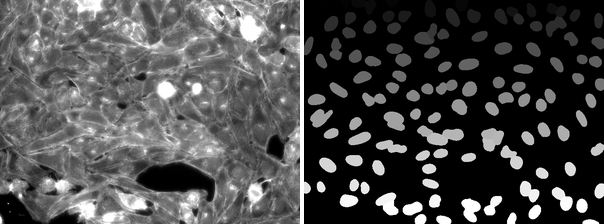

| | | | |
|---|---|---|---|
| **Dim** | 2D | **Imaging mode** | fluorescence |
| **Modality** | grayscale | **Data type** | real |
| **Image size** | varies | **Resolution** | — |
| **Instrument** | — | **Images** | 1536 |
| **Task** | segmentation | **Labels** | foreground |
| **DOI** | — | **License** | — |

</details>

<details>
<summary><b><a href="https://bbbc.broadinstitute.org/BBBC007">BBBC007</a></b> — Drosophila Kc167 cells for cell boundary segmentation · 2D · real · fluorescence · segmentation · 32 images</summary>

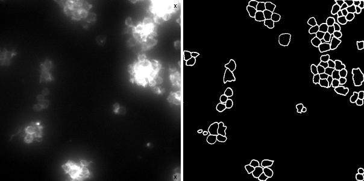 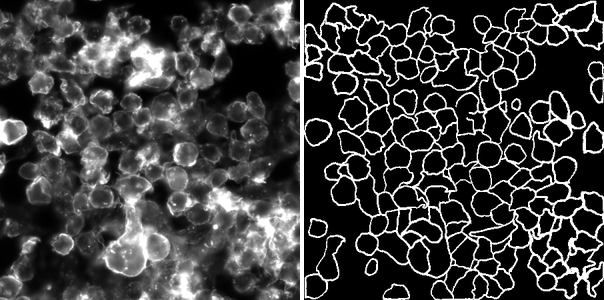 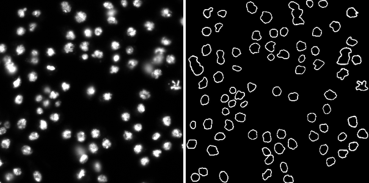

| | | | |
|---|---|---|---|
| **Dim** | 2D | **Imaging mode** | fluorescence |
| **Modality** | grayscale | **Data type** | real |
| **Image size** | 512×512 | **Resolution** | — |
| **Instrument** | Zeiss Axioplan 2 | **Images** | 32 |
| **Task** | segmentation | **Labels** | outlines |
| **DOI** | 10.1038/nmeth.2083 | **License** | CC0-1.0 |

</details>

<details>
<summary><b><a href="https://bbbc.broadinstitute.org/BBBC008">BBBC008</a></b> — Fluorescence microscopy images of human HT29 colon cancer cells · 2D · real · fluorescence · segmentation · 24 images</summary>

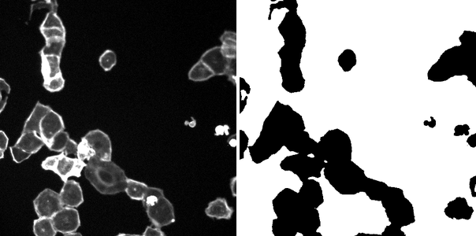 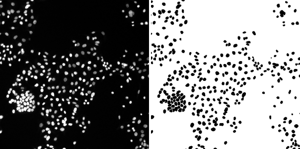 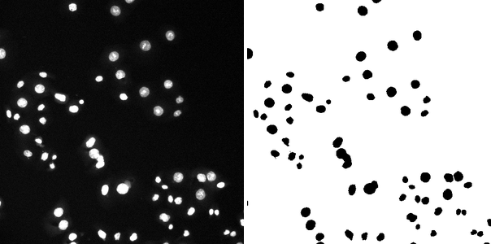

| | | | |
|---|---|---|---|
| **Dim** | 2D | **Imaging mode** | fluorescence |
| **Modality** | grayscale | **Data type** | real |
| **Image size** | varies | **Resolution** | — |
| **Instrument** | — | **Images** | 24 |
| **Task** | segmentation | **Labels** | foreground |
| **DOI** | — | **License** | — |

</details>

<details>
<summary><b><a href="https://bbbc.broadinstitute.org/BBBC009">BBBC009</a></b> — Human red blood cells (DIC images) · 2D · real · dic · segmentation · 5 images</summary>

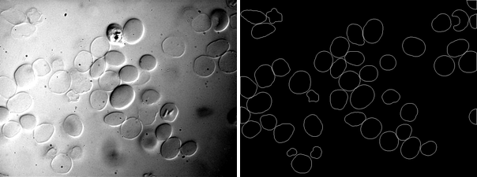 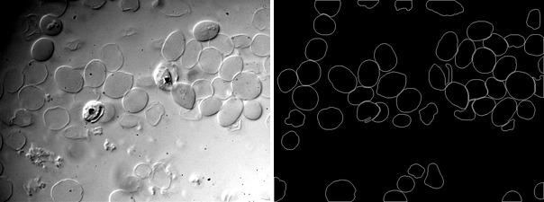 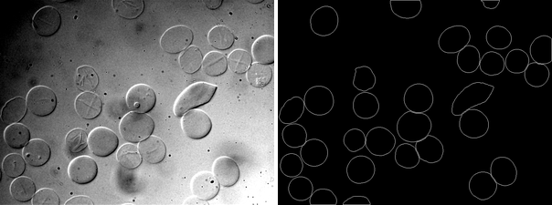

| | | | |
|---|---|---|---|
| **Dim** | 2D | **Imaging mode** | dic |
| **Modality** | grayscale | **Data type** | real |
| **Image size** | 600×800 | **Resolution** | — |
| **Instrument** | — | **Images** | 5 |
| **Task** | segmentation | **Labels** | outlines |
| **DOI** | 10.1038/nmeth.2083 | **License** | CC0-1.0 |

</details>

<details>
<summary><b><a href="https://bbbc.broadinstitute.org/BBBC010">BBBC010</a></b> — Live/dead assay of C. elegans exposed to pathogens · 2D · real · brightfield_fluorescence · segmentation · 200 images</summary>

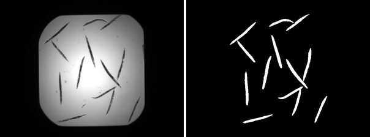 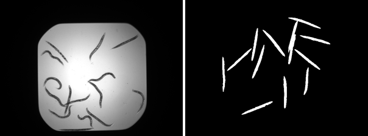 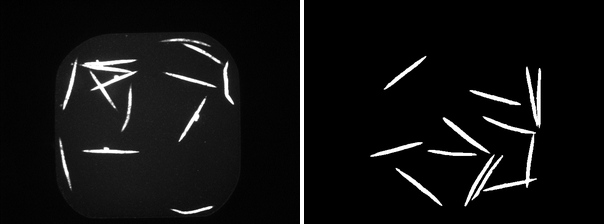

| | | | |
|---|---|---|---|
| **Dim** | 2D | **Imaging mode** | brightfield_fluorescence |
| **Modality** | grayscale | **Data type** | real |
| **Image size** | varies | **Resolution** | — |
| **Instrument** | — | **Images** | 200 |
| **Task** | segmentation | **Labels** | foreground |
| **DOI** | — | **License** | — |

</details>

<details>
<summary><b><a href="https://bbbc.broadinstitute.org/BBBC018">BBBC018</a></b> — Human HT29 colon-cancer cells (diverse phenotypes) · 2D · real · fluorescence · segmentation · 168 images</summary>

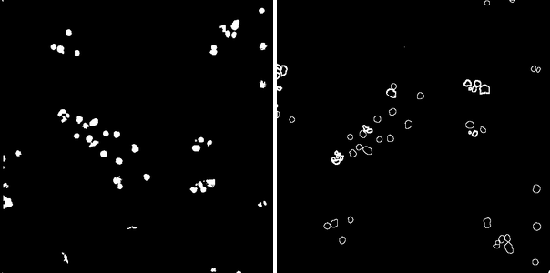 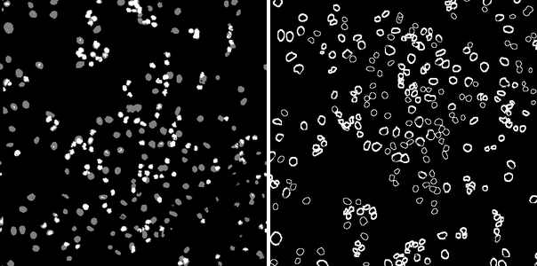 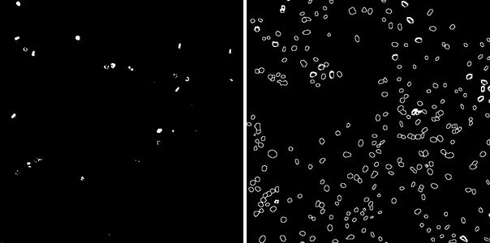

| | | | |
|---|---|---|---|
| **Dim** | 2D | **Imaging mode** | fluorescence |
| **Modality** | grayscale | **Data type** | real |
| **Image size** | 512×512 | **Resolution** | — |
| **Instrument** | Cellomics ArrayScan | **Images** | 168 |
| **Task** | segmentation | **Labels** | outlines |
| **DOI** | 10.1038/nmeth.2083 | **License** | CC-BY-NC-SA-3.0 |

</details>

<details>
<summary><b><a href="https://bbbc.broadinstitute.org/BBBC019">BBBC019</a></b> — Collective cell migration (wound healing, DIC images) · 2D · real · dic · segmentation · 165 images</summary>

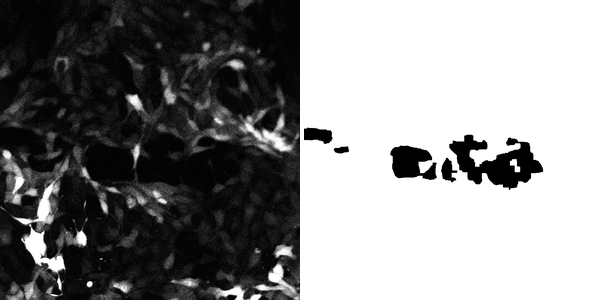 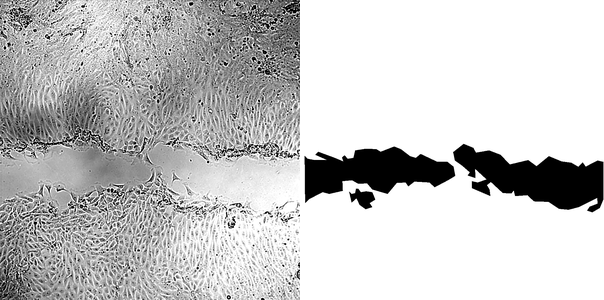 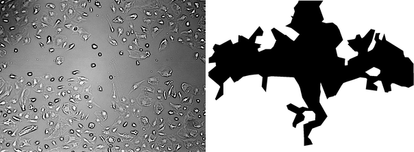

| | | | |
|---|---|---|---|
| **Dim** | 2D | **Imaging mode** | dic |
| **Modality** | grayscale | **Data type** | real |
| **Image size** | varies | **Resolution** | — |
| **Instrument** | — | **Images** | 165 |
| **Task** | segmentation | **Labels** | foreground |
| **DOI** | 10.1038/nmeth.2083 | **License** | CC-BY-3.0 |

</details>

<details>
<summary><b><a href="https://bbbc.broadinstitute.org/BBBC020">BBBC020</a></b> — Murine bone-marrow derived macrophages (overlapping cells) · 2D · real · fluorescence · segmentation · 75 images</summary>

 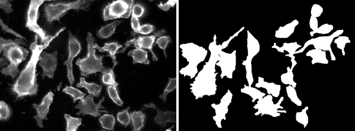 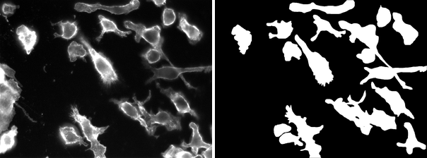

| | | | |
|---|---|---|---|
| **Dim** | 2D | **Imaging mode** | fluorescence |
| **Modality** | multichannel | **Data type** | real |
| **Image size** | 1040×1388 | **Resolution** | — |
| **Instrument** | — | **Images** | 75 |
| **Task** | segmentation | **Labels** | instance |
| **DOI** | 10.1038/nmeth.2083 | **License** | CC-BY-NC-SA-3.0 |

</details>

<details>
<summary><b><a href="https://bbbc.broadinstitute.org/BBBC024">BBBC024</a></b> — 3D Synthetic HL60 Cell Line Images with Varying Clustering Probability and SNR · 3D · synthetic · fluorescence · segmentation · 90 images</summary>

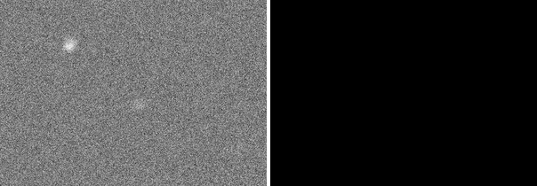  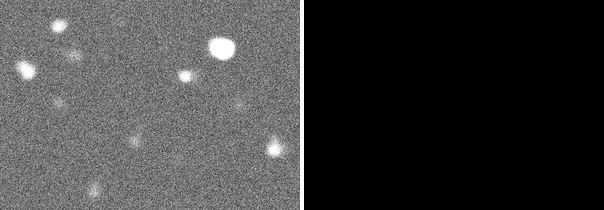

| | | | |
|---|---|---|---|
| **Dim** | 3D | **Imaging mode** | fluorescence |
| **Modality** | grayscale | **Data type** | synthetic |
| **Image size** | varies | **Resolution** | — |
| **Instrument** | — | **Images** | 90 |
| **Task** | segmentation | **Labels** | foreground |
| **DOI** | — | **License** | — |

</details>

<details>
<summary><b><a href="https://bbbc.broadinstitute.org/BBBC027">BBBC027</a></b> — 3D Synthetic Colon Tissue Images with Varying SNR · 3D · synthetic · fluorescence · segmentation · 30 images</summary>

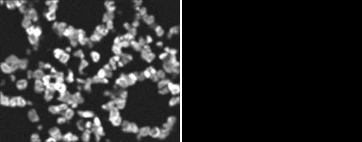 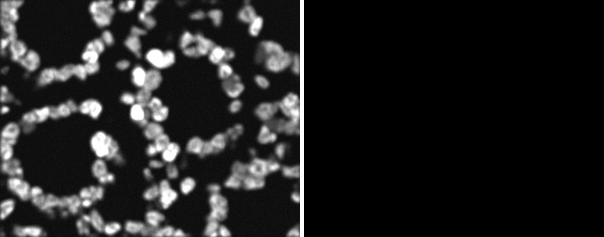 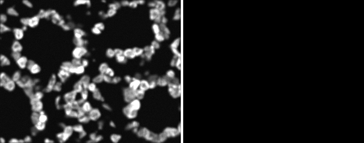

| | | | |
|---|---|---|---|
| **Dim** | 3D | **Imaging mode** | fluorescence |
| **Modality** | grayscale | **Data type** | synthetic |
| **Image size** | varies | **Resolution** | — |
| **Instrument** | — | **Images** | 30 |
| **Task** | segmentation | **Labels** | foreground |
| **DOI** | — | **License** | — |

</details>

<details>
<summary><b><a href="https://bbbc.broadinstitute.org/BBBC028">BBBC028</a></b> — Polymerized Structures in Differential Interference Contrast (DIC) Microscopy · 2D · real · dic · segmentation · 60 images</summary>

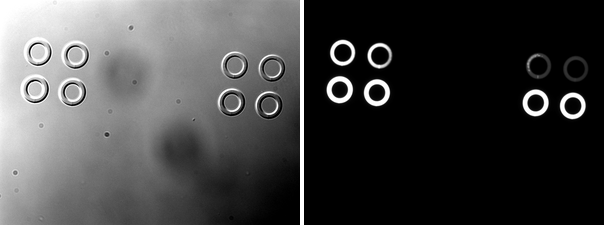 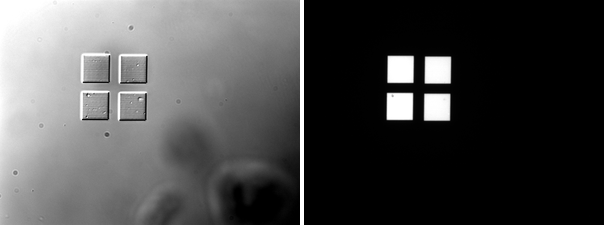 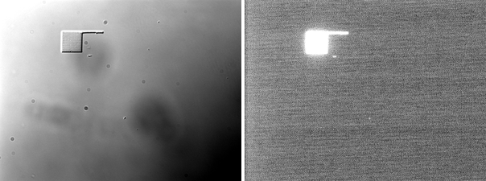

| | | | |
|---|---|---|---|
| **Dim** | 2D | **Imaging mode** | dic |
| **Modality** | grayscale | **Data type** | real |
| **Image size** | varies | **Resolution** | — |
| **Instrument** | — | **Images** | 60 |
| **Task** | segmentation | **Labels** | foreground |
| **DOI** | — | **License** | — |

</details>

<details>
<summary><b><a href="https://bbbc.broadinstitute.org/BBBC029">BBBC029</a></b> — Synthetic Differential Interference Contrast (DIC) Images · 2D · synthetic · dic · segmentation · 218 images</summary>

  

| | | | |
|---|---|---|---|
| **Dim** | 2D | **Imaging mode** | dic |
| **Modality** | grayscale | **Data type** | synthetic |
| **Image size** | varies | **Resolution** | — |
| **Instrument** | — | **Images** | 218 |
| **Task** | segmentation | **Labels** | foreground |
| **DOI** | — | **License** | — |

</details>

<details>
<summary><b><a href="https://bbbc.broadinstitute.org/BBBC030">BBBC030</a></b> — Chinese Hamster Ovary (CHO) cells (DIC images) · 2D · real · dic · segmentation · 60 images</summary>

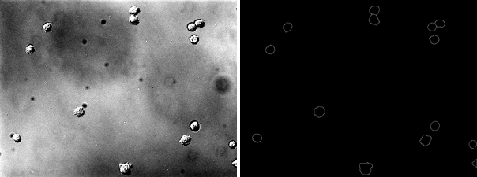 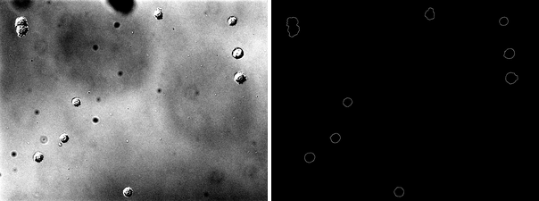 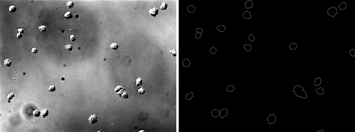

| | | | |
|---|---|---|---|
| **Dim** | 2D | **Imaging mode** | dic |
| **Modality** | grayscale | **Data type** | real |
| **Image size** | 1032×1376 | **Resolution** | — |
| **Instrument** | Olympus Cell-R (20x) | **Images** | 60 |
| **Task** | segmentation | **Labels** | outlines |
| **DOI** | — | **License** | CC-BY-3.0 |

</details>

<details>
<summary><b><a href="https://bbbc.broadinstitute.org/BBBC032">BBBC032</a></b> — 3D Mouse Embryo Blastocyst Cells · 2D · real · fluorescence · segmentation · 4 images</summary>

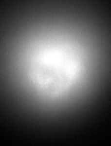  

| | | | |
|---|---|---|---|
| **Dim** | 2D | **Imaging mode** | fluorescence |
| **Modality** | grayscale | **Data type** | real |
| **Image size** | varies | **Resolution** | — |
| **Instrument** | — | **Images** | 4 |
| **Task** | segmentation | **Labels** | foreground |
| **DOI** | — | **License** | — |

</details>

<details>
<summary><b><a href="https://bbbc.broadinstitute.org/BBBC033">BBBC033</a></b> — 3D Mouse Trophoblast Stem Cells · 2D · real · fluorescence · segmentation · 2 images</summary>

 

| | | | |
|---|---|---|---|
| **Dim** | 2D | **Imaging mode** | fluorescence |
| **Modality** | grayscale | **Data type** | real |
| **Image size** | varies | **Resolution** | — |
| **Instrument** | — | **Images** | 2 |
| **Task** | segmentation | **Labels** | foreground |
| **DOI** | — | **License** | — |

</details>

<details>
<summary><b><a href="https://bbbc.broadinstitute.org/BBBC034">BBBC034</a></b> — 3D Induced Pluripotent Human Stem Cells (hiPSC) · 2D · real · brightfield_fluorescence · segmentation · 10 images</summary>

  

| | | | |
|---|---|---|---|
| **Dim** | 2D | **Imaging mode** | brightfield_fluorescence |
| **Modality** | grayscale | **Data type** | real |
| **Image size** | varies | **Resolution** | — |
| **Instrument** | — | **Images** | 10 |
| **Task** | segmentation | **Labels** | foreground |
| **DOI** | — | **License** | — |

</details>

<details>
<summary><b><a href="https://bbbc.broadinstitute.org/BBBC035">BBBC035</a></b> — Simulated HL60 Cells from the Cell Tracking Challenge · 2D · synthetic · fluorescence · segmentation · 230 images</summary>

  

| | | | |
|---|---|---|---|
| **Dim** | 2D | **Imaging mode** | fluorescence |
| **Modality** | grayscale | **Data type** | synthetic |
| **Image size** | varies | **Resolution** | — |
| **Instrument** | — | **Images** | 230 |
| **Task** | segmentation | **Labels** | foreground |
| **DOI** | — | **License** | — |

</details>

<details>
<summary><b><a href="https://bbbc.broadinstitute.org/BBBC038">BBBC038</a></b> — Kaggle 2018 Data Science Bowl - Nuclei Segmentation · 2D · real · fluorescence · segmentation · 664 images</summary>

  

| | | | |
|---|---|---|---|
| **Dim** | 2D | **Imaging mode** | fluorescence |
| **Modality** | grayscale | **Data type** | real |
| **Image size** | varies | **Resolution** | — |
| **Instrument** | — | **Images** | 664 |
| **Task** | segmentation | **Labels** | foreground |
| **DOI** | — | **License** | — |

</details>

<details>
<summary><b><a href="https://bbbc.broadinstitute.org/BBBC039">BBBC039</a></b> — Nuclei of U2OS Cells in a Chemical Screen · 2D · real · fluorescence · segmentation · 200 images</summary>

  

| | | | |
|---|---|---|---|
| **Dim** | 2D | **Imaging mode** | fluorescence |
| **Modality** | grayscale | **Data type** | real |
| **Image size** | 520×696 | **Resolution** | — |
| **Instrument** | — | **Images** | 200 |
| **Task** | segmentation | **Labels** | instance |
| **DOI** | — | **License** | — |

</details>

<details>
<summary><b><a href="https://bbbc.broadinstitute.org/BBBC044">BBBC044</a></b> — Mouse hippocampal presynaptic terminals (vGlut-1 and vGat) · 3D · real · fluorescence · counting · 12 images</summary>

  

| | | | |
|---|---|---|---|
| **Dim** | 3D | **Imaging mode** | fluorescence |
| **Modality** | grayscale | **Data type** | real |
| **Image size** | 15×1024×1024 | **Resolution** | — |
| **Instrument** | Zeiss LSM 710 (63x oil) | **Images** | 12 |
| **Task** | counting | **Labels** | — |
| **DOI** | 10.3389/fnana.2018.00037 | **License** | CC-BY-NC-SA-3.0 |

</details>

<details>
<summary><b><a href="https://bbbc.broadinstitute.org/BBBC046">BBBC046</a></b> — FiloData3D - Synthetic 3D Time-Lapse Imaging of A549 Cells with Filopodia · 2D · synthetic · fluorescence · segmentation · 30 images</summary>

  

| | | | |
|---|---|---|---|
| **Dim** | 2D | **Imaging mode** | fluorescence |
| **Modality** | grayscale | **Data type** | synthetic |
| **Image size** | varies | **Resolution** | — |
| **Instrument** | — | **Images** | 30 |
| **Task** | segmentation | **Labels** | foreground |
| **DOI** | — | **License** | — |

</details>

<details>
<summary><b><a href="https://bbbc.broadinstitute.org/BBBC050">BBBC050</a></b> — Nuclei of Mouse Embryonic Cells · 2D · real · fluorescence · segmentation · 165 images</summary>

  

| | | | |
|---|---|---|---|
| **Dim** | 2D | **Imaging mode** | fluorescence |
| **Modality** | grayscale | **Data type** | real |
| **Image size** | varies | **Resolution** | — |
| **Instrument** | — | **Images** | 165 |
| **Task** | segmentation | **Labels** | foreground |
| **DOI** | — | **License** | — |

</details>


---

## 🎨 Visualizing Dataset Samples

### **Display First Image from Each Dataset**

##### Requires downloading datasets first!

You can display samples from the datasets. 
Similar to listing datasets, you can filter the samples to show only 2D, only 3D, or both types of datasets.

```python
from examples.load_dataset import display_dataset_samples

# Display samples from all datasets
display_dataset_samples()

# Display samples from only 2D datasets
display_dataset_samples(filter_3d=False)

# Display samples from only 3D datasets
display_dataset_samples(filter_3d=True)
```

---

## 📥 Download and Load a Dataset

### **Load a Dataset as a PyTorch Dataset**

```python
from bbbc_datasets.datasets.bbbc004 import BBBC004
from torch.utils.data import DataLoader

# Load BBBC004 dataset
dataset = BBBC004()

# Create a DataLoader
dataloader = DataLoader(dataset, batch_size=4, shuffle=True)

# Iterate through data
for images, labels in dataloader:
    print(f"Batch shape: {images.shape}, Labels: {labels.shape if labels is not None else 'None'}")
```

`DatasetManager.filter_datasets` filters the dataset classes by metadata
without triggering any downloads (see [Filtering by metadata](#filtering-by-metadata)):

```python
from bbbc_datasets.dataset_manager import DatasetManager

# All datasets
datasets_all = DatasetManager.filter_datasets()

# All 3D datasets (legacy filter_3d still works)
datasets_3d = DatasetManager.filter_datasets(filter_3d=True)

# Or filter by any metadata field
datasets_dic = DatasetManager.filter_datasets(imaging_mode="dic")
```

### **Dataset-Specific Options**

Some datasets ship in several variants and can be loaded selectively:

```python
# Only one of the eight wound-healing subsets of BBBC019
dataset = BBBC019(subset="MDCK")

# Only the vGat marker of the 3D BBBC044 stacks
dataset = BBBC044(marker="vgat")
```

---

## 🛠 Running Tests

<details>
<summary> Validate Dataset URLs </summary>

**Checks if all dataset URLs are reachable** 🌍

```bash
python -m unittest tests/test_urls.py
```

</details>

<details>
<summary> Verify Dataset Loading </summary>

**Ensures datasets can be loaded and accessed correctly** 🛠

```bash
python -m unittest tests/test_dataset_loading.py
```

</details>

---

## 📝 Up-next

- **Complete the non-BBBC stubs:** `cellpose` and `livecell` are partial, `sartorius` needs its class body fixed, and `evican`/`isbi15` are empty placeholders.
- **Cell Painting profiling sets** (BBBC025/036/047): multi-channel image-profiling data, a different paradigm from the current segmentation focus.
- **Biological-label sets** (BBBC041/042/045): only bounding boxes / biological labels, no segmentation masks yet.

---

## 🆕 v1.0.0 highlights

- **9 new BBBC datasets:** BBBC001, BBBC002, BBBC007, BBBC009, BBBC018, BBBC019, BBBC020, BBBC030, BBBC044 (now 27 total).
- **Robust downloading:** per-file markers so multi-archive datasets (e.g. the 8 BBBC019 subsets) no longer skip files; metadata files are downloaded into a `metadata/` folder.
- **Correct image/label discovery:** deep recursive listing, `__MACOSX` junk filtering, and exact stem matching before fuzzy matching (fixes BBBC039 label mismatches).
- **Working PyTorch wrapper:** `DatasetManager.get_dataset` / `DataLoader` now return correct per-sample `(image, label)` tensors for 2D, 3D, RGB and ArrayScan `.DIB` inputs.

---

## 🙌 Contributing

Contributions are welcome! If you find issues or want to add new features, feel free to:

- **Submit a Pull Request**
- **Report Issues** in the GitHub Issues section

---

## 📜 License

This project is licensed under the **MIT License**.
